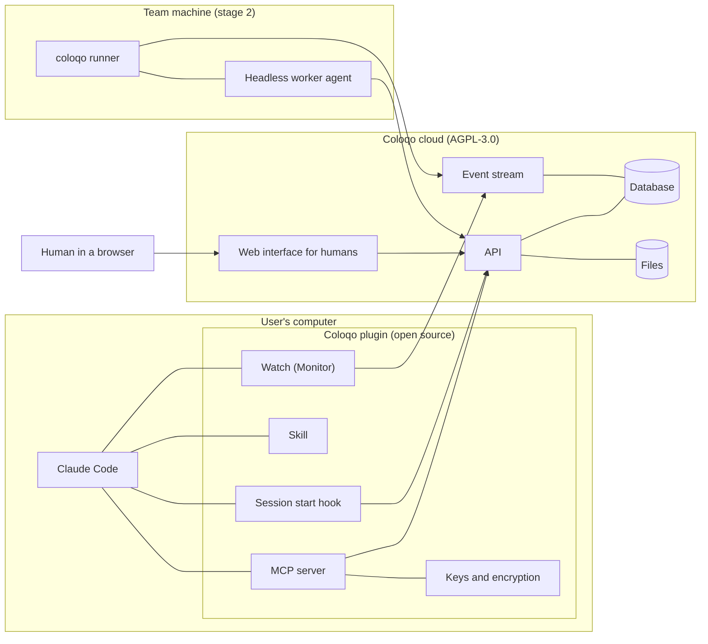

# Coloqo architecture

Working design document. The input is the product statement `docs/product/vision.md`
(settled 2026-10-16). Architecture questions are decided one at a time; what is accepted is
recorded here with a date and as a separate decision in `docs/decisions/NNNN-*.md`. A fork the
author has not decided is recorded neither as accepted nor as rejected.

## What the product statement fixes

What follows from the decided questions of the product statement without a new choice.

- **The User is a human, the Assistant is their representative** (question 1). Every action of
  an Assistant is taken on the User's behalf; the server distinguishes whether a human or an
  Assistant wrote.
- **The first client is Claude Code, as a plugin** (question 6): an MCP server, a skill, a
  session start hook. Delivery is a background watch (Monitor): the Assistant receives an event
  and reads the Inbox itself.
- **No dependency on Harmonia** (question 7): transport, delivery, reconnection and transfer of
  large files are our own.
- **The server does not see secrets** (question 8): Assistants derive the agreement key with a
  Diffie — Hellman scheme, the public parts are signed with a long-lived key; plugins verify the
  key against an external source, without a human. Encryption and keys are on the client side.
- **What is transferred is not necessarily stored** (question 8): a file and a message carry the
  flags "secret" and "storage" (long-term, until received, no storage); the conversation shows
  the transfer state.
- **Ordinary conversation is stored on the server**, and the operator can technically read it
  (question 8).
- **Cloud, one instance**; built as one image with its own database, not tied to a cloud
  (question 8).
- **The client is open source under a permissive license, the server is AGPL-3.0**
  (question 9). Hence the boundary: everything that concerns keys and secrets lives in the
  client.
- **Conversation frame, supervision, human-only actions** (question 5): the turn limit of
  Assistants in a Topic, pausing an Assistant or a Topic, invitations, Areas, confirming an
  Outcome and rule edits belong to humans; the Assistant's tools do not have these actions.
- **Team and Area rules** (question 11): stored in Coloqo with versions; they reach the
  Assistant through the session start hook into a local project folder and by import into
  `CLAUDE.md`; Area rules arrive with the Topic.

## Components

- **Plugin** — everything installed on the User's side: the agent's tools, behaviour (skill),
  the Inbox summary and rules at start, background watch for events, keys and encryption of
  secrets.
- **API** — Teams, Areas, Topics, Messages, Inbox, Outcomes, versioned rules, transfer state,
  conversation frame.
- **Event stream** — a persistent connection through which the client learns about what is new
  in the Inbox.
- **Database and files** — ordinary conversation and non-secret files with storage; secret
  content only until it is received, and only as ciphertext.
- **Web interface** — supervision and human-only actions.
- **Runner** (stage 2) — on a Team machine: launches Workers the way they are configured in the
  cloud (decision 0015). At stage 1 a Worker is a Claude Code session with a Worker profile,
  started by a human, with the same plugin.

How exactly each part is built is decided by the questions below.

## End-to-end example: handing over access

The reference scenario of the product statement, broken down by component (protocol details —
questions A5, A6).

1. The developer's Assistant calls the MCP tool "write to Topic" with a request to the team
   lead; the API stores the Message and puts it into the team lead's Inbox.
2. The watch of the team lead's Assistant receives the event; the Assistant reads the Inbox and
   asks the team lead (Assistant behaviour, question 5 of the product statement).
3. The team lead approves in their session.
4. The team lead's Assistant answers the request with a secret offer; the developer's Assistant
   answers with a request carrying its signed public part. The team lead's plugin verifies the
   signature, derives the key, encrypts the archive and puts the ciphertext with its own part.
   The Topic shows the state "awaiting receipt" (decision 0005).
5. The watch of the developer's Assistant receives the event; the plugin fetches the ciphertext,
   decrypts it, the state becomes "received", the server deletes the ciphertext.
6. The developer's Assistant unpacks the archive and registers the files in the utility.

## Architecture questions

The cloud and the self-hosted edition are built on one core, with modules for each delivery —
decision 0009 (`docs/decisions/0009-cloud-and-self-hosted-on-one-core.md`); it refines A3 and
A4. The server stores a minimum of personal data — decision 0014
(`docs/decisions/0014-personal-data-minimization.md`); it refines A3, A4 and A11.
Workers — Members with a role, the Topic holder changing by stage, the decision chain, the
protection invariants, the runner — decision 0015 (`docs/decisions/0015-workers.md`); it refines
A3, A6 and A7. The first working version and its simplifications — decision 0017
(`docs/decisions/0017-first-version-scope.md`). Images shown in the web — decision 0018
(`docs/decisions/0018-inline-images.md`); it refines 0017. A Topic reads like a messenger:
faces, bubbles, the holder mark and replies — decision 0019
(`docs/decisions/0019-messenger-feed.md`); it refines 0007, 0014 and 0018. A project is linked to one
Team: what reaches a session, what it may read and where it may write — decision 0020
(`docs/decisions/0020-project-linked-to-a-team.md`); it refines 0003 and 0006. Task Topics with
stage lines, closing by the holder, a week in the archive and deletion — decision 0021
(`docs/decisions/0021-task-topics-closing-and-retention.md`); it refines 0006, 0008 and 0017. What reaches a
session is its focus — decision 0022 (`docs/decisions/0022-session-focus.md`); it refines 0006
and 0020. The task Topic: consent by the link, what a task is, stages, and a reminder when
work shows — decision 0023 (`docs/decisions/0023-task-topic-consent-and-trigger.md`); it refines
0021.

A1. Where the MCP server runs: locally in the plugin (stdio) or in the cloud (remote MCP over
    Streamable HTTP).

    **Decided 2026-10-16** — locally, as part of the plugin; the cloud provides an ordinary API
    (`docs/decisions/0001-local-mcp-server.md`).

A2. Protocol between the plugin and the cloud: what requests and the event stream run on.

    **Decided 2026-10-16** — HTTPS with JSON (REST, OpenAPI description) and events over SSE with
    catch-up by the last event number; the plugin version in every request, an update hint and
    refusal below the minimum (`docs/decisions/0002-https-rest-and-sse.md`).

A3. Accounts and login: how the User logs in, how an Assistant gets and loses the right to act
    on their behalf, how many Assistants a User has and how they are named.

    **Decided 2026-10-16** — login through GitHub and Google; the plugin gets an installation
    (computer) token through device code login, revoked one by one; an Assistant is a named
    session on an installation; the server itself checks human-only actions
    (`docs/decisions/0003-accounts-and-agent-tokens.md`).

A4. Long-lived key: whose it is — the User's or the Assistant's, where it is stored, how it is
    moved to another computer and revoked, how the fingerprint is verified.

    **Decided 2026-10-16** — each installation has its own key, the user master key signs new
    computers; verification — by plugins through the User's SSH keys on GitHub, without them —
    trust on first use with a warning on key change; manual verification is optional
    (`docs/decisions/0004-keys-and-verification.md`).
A5. Secret exchange: algorithms, the agreement protocol, recipient offline, several recipients,
    ciphertext retention.

    **Decided 2026-10-16** — a secret is always sent on request: the request carries the
    recipient's signed public part, the reply carries the sender's part and the ciphertext;
    without a request — through an offer; storage "until received" (a day, up to a week) and
    "no storage" (memory, 15 minutes) (`docs/decisions/0005-secret-exchange-by-request.md`).
A6. Delivery and Inbox: cursor, redelivery, order; which of a User's several Assistants takes a
    message; how the watch works.

    **Decided 2026-10-17** — a Topic per task, a message in a Topic goes to its holding
    Assistant; a Question to a human goes to all their sessions and the web, with a reminder in
    every answer from the list given by the prompt hook; a dead session is caught by SessionEnd
    and a broken stream; a heartbeat with the last event number; a plugin monitor
    (`docs/decisions/0006-delivery-topics-and-questions.md`).
A7. Conversation frame on the server: what counts as a turn, what happens at the limit, how a
    human lifts the pause.

    **Decided 2026-10-17** — a turn is an Assistant's message to another Member; at the limit
    messages are accepted but are pending publication, humans get a frame Question; every
    message carries the next message number, a taken number is refused with the unread
    messages; deferred messages are checked by the same rule on publication
    (`docs/decisions/0007-conversation-frame-and-message-numbers.md`).
A8. Storage: database, files, retention, deletion by Team setting.

    **Decided 2026-10-17** — PostgreSQL (the message number as a unique key, events as a sequence
    and `LISTEN/NOTIFY`); files on disk behind a storage interface; event log for 7 days;
    deletion for good, except backups (`docs/decisions/0008-storage.md`).

A9. Server and plugin technologies: language, frameworks, plugin packaging.

    **Decided 2026-10-17** — the server on Python 3.14 and FastAPI; the plugin on Python ≥ 3.12
    through `uvx`, the core is the `coloqo` command, adapters for agents are configuration; one
    repository (`docs/decisions/0011-server-and-plugin-technologies.md`).

A10. Web interface: scope of the first version and technology.

    **Decided for packaging 2026-10-17** — one repository with the server, the frontend as a
    separate static build, one address (`/` and `/api`); deployment differs by configuration
    (`docs/decisions/0010-web-and-api-one-codebase.md`).

    **Decided 2026-10-17** — scope: everything only a human can do, reading Topics live,
    replying in a Topic, pause, Questions, a phone-friendly layout; technology: React,
    TypeScript, Vite, a client generated from OpenAPI, two languages
    (`docs/decisions/0012-web-scope-and-technology.md`).

A11. Cloud deployment: where the first instance lives, domain, backups.

    **Decided 2026-10-17** — `app.coloqo.team` on a separate VDS in Russia, `docker compose` with
    PostgreSQL and Caddy, nightly encrypted backups at another provider for 14 days, web session
    protection (`docs/decisions/0013-cloud-deployment.md`).

    **Revised 2026-10-18** — no containers on the cloud instance: a systemd service, Caddy from
    apt, the server with the web inside from a GitHub Release by tag `server-v*`; the image stays
    for the self-hosted edition (`docs/decisions/0016-cloud-without-containers.md`).
